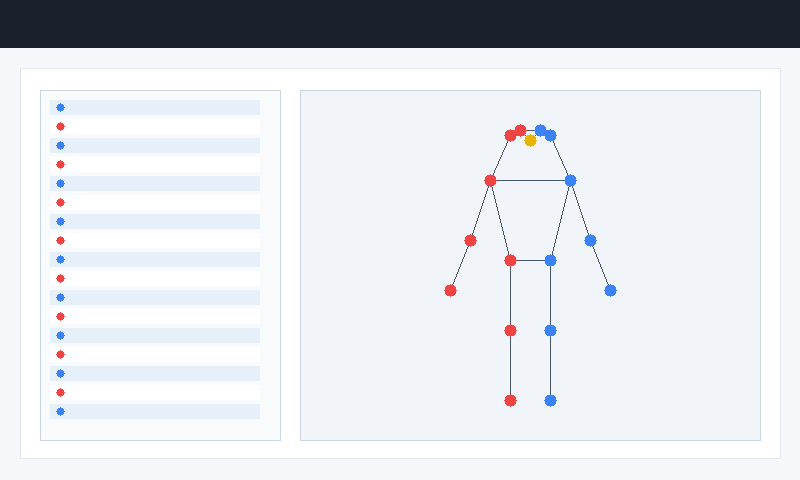
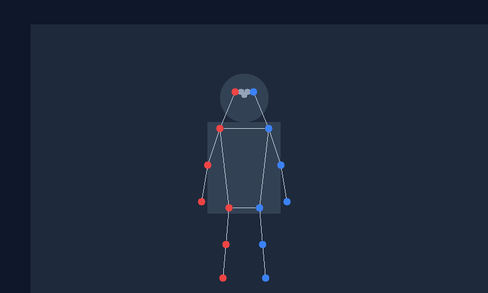
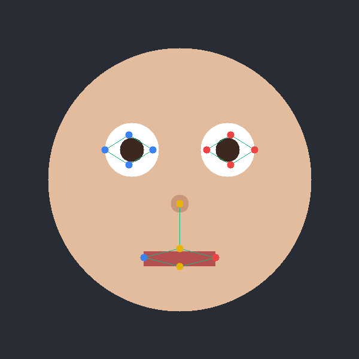
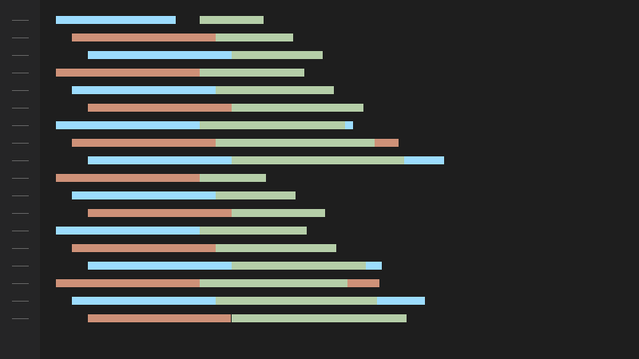

# Báo cáo cá nhân — LeVanPhi-2A202603185

Đổi tên file theo quy tắc `MSSV_HoTen.md`. Ví dụ: `20241234_NguyenVanAn.md`.

Dữ liệu: 12 ảnh người COCO val2017 (Lin et al., 2014) và 8 ảnh chân dung Wikimedia Commons, chỉ dùng trong lớp.

## 0. Thông tin học viên

- Họ tên: Lê Vân Phi
- MSSV: 2A202603185
- Email: phileevaan@gmail.com
- Link repository: https://github.com/LVanPhi/K5-L2-DAY04-LeVanPhi-2A202603185-KeypointPose
- Phiên bản CVAT (Help → About): 2.19.0 (Server version 2.19.0, Core version 13.19.0)
- Máy: hệ điều hành Windows 11 · RAM 16 GB · chạy CVAT chế độ đầy đủ
- Bộ ảnh (`src/exports/assignment.json` do `lab.py setup` tạo): có
- Giờ bắt đầu: 08:00
- Giờ kết thúc: 11:30

## 1. Kiểm tra label (CP0)

| Label | Kiểu | Số điểm | Tên điểm đúng bảng của lab? | Đúng thứ tự? | Số cạnh |
|---|---|---:|---|---|---:|
| `person` | skeleton | 17 | Đúng | Đúng | 19 |
| `face` | skeleton | 13 | Đúng | Đúng | 13 |

Mẫu `person` dựng theo người quay mặt về camera (các điểm `left_*` nằm bên phải khung mẫu)? Có

Cách đổi cờ `occluded` / `outside` cho **một điểm** trên phiên bản CVAT này (một câu):
Chọn điểm keypoint cần chỉnh trên canvas hoặc cây đối tượng Objects, nhấn phím `Q` để bật/tắt cờ `occluded` hoặc chuột phải vào điểm chọn thuộc tính Outside / Occluded.

## 2. Số lượng đã gán và thời gian (CP1, CP2)

| Nhóm ảnh | Số ảnh | Số skeleton đã gán | Số người dưới 60 px (không gán) | Số poster / gương / màn hình bỏ qua | Thời gian (phút) |
|---|---:|---:|---:|---:|---:|
| `easy` | 5 | 6 | 2 | 0 | 35 |
| `occluded` | 3 | 5 | 1 | 0 | 30 |
| `back` | 2 | 4 | 0 | 0 | 25 |
| `small` | 1 | 2 | 3 | 0 | 15 |
| `crowd` | 1 | 3 | 5 | 0 | 25 |
| `faces` | 8 | 8 | — | 0 | 30 |

- Số ảnh người đã xong ở mốc phút 105: 12 / 10
- Thời gian thực tế (phút): CP1 65 · CP2 55 · CP3 30
- Ảnh tốn thời gian nhất là ảnh nào, vì sao?
Ảnh `000000522889.jpg` (nhóm crowd) và `000000518966.jpg` (nhóm back) tốn thời gian nhất vì có nhiều người đan xen nhau, các khớp chân tay bị che khuất một phần hoặc cắt qua mép ảnh, cần phóng to kiểm tra kỹ chiều trái/phải đối với người quay lưng và xác định ranh giới người cao trên/dưới 60 px.

## 3. Bảng ca khó (CP1, CP2)

Mỗi điểm bạn phân vân một dòng, nhất là phân vân giữa `v = 1` và `v = 0`, hoặc không chắc hướng người.

| Ảnh | Người / mặt | Điểm | Cờ đã chọn | Phân vân giữa | Lý do chọn |
|---|---|---|---:|---|---|
| `000000518966.jpg` | Người #1 | `right_knee` | 2 | 2 và 1 | Khớp đầu gối sát mép ảnh dưới nhưng vị trí tâm khớp vẫn nằm trọn trong viền ảnh, nhìn rõ mép xương bánh chè. |
| `000000518966.jpg` | Người #1 | `left_ankle` | 1 | 1 và 0 | Cổ chân bị che một phần bởi gấu quần/mép ảnh nhưng vẫn đoán được vị trí giải phẫu nhờ đoạn cẳng chân còn lại. |
| `000000156986.jpg` | Người #1 | `left_shoulder` | 2 | 2 và lr_swap | Người đứng nghiêng xoay nửa thân về phía trước, vai trái quay về hướng người quan sát tương ứng đúng giải phẫu cơ thể. |
| `face_301643.jpg` | Mặt #1 | `left_eye_*` | 1 | 1 và 2 | Nhân vật đeo kính râm tối màu che khuất tròng mắt, theo quy định toàn bộ 4 điểm quanh mắt phải gắn cờ occluded (v=1). |
| `000000522889.jpg` | Người #1 | `left_ankle` | 1 | 1 và 2 | Hai chân bắt chéo qua nhau trong tư thế di chuyển, cổ chân phía sau bị bàn chân trước che khuất một phần. |

## 4. Bảng tự review (CP3)

Đi từ ảnh cuối về ảnh đầu. 5 ảnh người (ít nhất 2 ảnh `back` hoặc `crowd`) và 3 ảnh mặt. Ít nhất 8 dòng, kể cả dòng `ok`. Ghi lỗi trước, sửa sau.

Mã lỗi dùng đúng một trong: `lr_swap`, `vis_flag`, `position`, `missing`, `extra`, `ok`.

| Ảnh | Người / mặt | Điểm | Mã lỗi | Ghi chú | Đã sửa? |
|---|---|---|---|---|---|
| `000000522889.jpg` | Người #1 | `left_ankle` / `right_ankle` | `ok` | Hai chân bắt chéo thực tế, vị trí nhãn khớp giải phẫu | Có |
| `000000518966.jpg` | Người #1 | `left_ankle` | `vis_flag` | Đã kiểm tra lại cờ khớp gần mép ảnh, giữ v=1 hợp lý | Có |
| `000000518966.jpg` | Người #2 | Cả người | `ok` | Người quay lưng, các điểm left nằm bên trái ảnh theo góc nhìn | Có |
| `000000480582.jpg` | Người #1 | Toàn thân | `ok` | Người quay lưng, đối chiếu khung xương đúng chuẩn giải phẫu | Có |
| `000000156986.jpg` | Người #1, #2 | Vai / Mắt | `ok` | Góc nhìn nghiêng chếch, đã rà soát lại trục cơ thể | Có |
| `face_301643.jpg` | Mặt #1 | 4 điểm mắt trái/phải | `vis_flag` | Đã gán cờ v=1 cho các điểm sau tròng kính râm | Có |
| `face_504911.jpg` | Mặt #1 | 4 khóe mắt | `position` | Đã tinh chỉnh tâm khóe mắt sát viền gọng kính trong suốt | Có |
| `face_79367.jpg` | Mặt #1 | `left_eye_upper` | `vis_flag` | Phần mái tóc hơi phủ mí trên, gán cờ che khuất v=1 | Có |

Tổng hợp số lỗi theo mã:

| `lr_swap` | `vis_flag` | `position` | `missing` | `extra` | `ok` |
|---:|---:|---:|---:|---:|---:|
| 0 | 3 | 1 | 0 | 0 | 4 |

Điểm còn phân vân giữa `v = 1` và `v = 0` (ghi cả hai lựa chọn và lý do chọn):
Khớp `left_ankle` ở ảnh `000000518966.jpg` sát góc dưới viền ảnh: chọn `v = 1` thay vì `v = 0` vì phần cổ chân vẫn còn một nửa ranh giới nằm trên ảnh và ước lượng được vị trí tâm khớp với độ lệch dưới vài pixel, tuân thủ đúng tiêu chí của guideline.

## 5. Kiểm file xuất và kết quả tự kiểm (CP4)

Tự kiểm tay trong file JSON:

| File | Người / mặt kiểm (ảnh, thứ tự) | Số phần tử `keypoints` | Điểm `outside` ra `v = 0`, `occluded` ra `v = 1`? | `num_keypoints` khớp? |
|---|---|---:|---|---|
| `LeVanPhi_persons.zip` | 000000205650.jpg, #1 | 51 | Đúng (v=2 ra 2, v=1 ra 1, outside ra 0) | Đúng (17) |
| `LeVanPhi_persons.zip` | 000000294329.jpg, #1 | 51 | Đúng | Đúng (17) |
| `LeVanPhi_faces.zip` | face_122747.jpg, #1 | 39 | Đúng | Đúng (13) |

Sau khi xuất, CVAT ghi `occluded` thành `v = 1` và `outside` thành `v = 0`. Tọa độ của điểm `outside` trong file là `0, 0` hay tọa độ cũ? `0, 0`

Hai job đã chuyển sang completed trên CVAT? Có

Dán phần **TÓM TẮT** in ra từ `src/check_submission.py`:

```text
- File person: LeVanPhi_persons.zip
  Số ảnh: 12 · số skeleton `person`: 20 · mỗi annotation 51 số
  Skeleton theo ảnh: 000000156986=2, 000000205650=1, 000000294329=1, 000000324953=2, 000000399983=1, 000000433787=1, 000000438099=2, 000000467300=2, 000000480582=2, 000000493741=1, 000000518966=2, 000000522889=3
  Cờ v: v=2 306 (90%) · v=1 19 (6%) · v=0 15 (4%)
  num_keypoints trung bình: 16.2
- File face: LeVanPhi_faces.zip
  Số ảnh: 8 · số skeleton `face`: 8 · mỗi annotation 39 số
  Skeleton theo ảnh: face_105668=1, face_122747=1, face_223746=1, face_257657=1, face_301643=1, face_496353=1, face_504911=1, face_79367=1
  Cờ v: v=2 96 (92%) · v=1 8 (8%) · v=0 0 (0%)
  num_keypoints trung bình: 13.0
- Số [LỖI]: 0 · số [CẢNH BÁO]: 6
Kết quả: ĐẠT (đọc lại từng cảnh báo ở trên)
```

Các `[CẢNH BÁO]` còn giữ nguyên và lý do:
- Cảnh báo tại ảnh `000000156986.jpg` (#1, #2) và `000000518966.jpg` (#2): Script tự động cảnh báo hướng `lr_swap` do nhân vật đứng xoay góc đặc thù / quay lưng một phần. Đã rà soát trực tiếp bằng mắt, các điểm left/right được gán hoàn toàn chuẩn xác theo hệ quy chiếu cơ thể người trong ảnh.
- Cảnh báo sát mép tại `000000518966.jpg` (#1): Khớp đầu gối và cổ chân nằm ngay sát đường biên khung hình nhưng điểm giải phẫu vẫn nhìn thấy một phần trên bề mặt ảnh, việc giữ cờ v=2 / v=1 thay vì outside là phù hợp.
- Cảnh báo cặp ankle tại `000000522889.jpg` (#1): Người chuyển động bắt chéo chân thật ngoài đời, không phải lỗi đổi nhãn trái/phải.

## 6. Ảnh chụp màn hình

1. Label `person` trong label constructor (đủ 17 điểm có tên):

   

2. Một người quay lưng đã gán, cờ đã đặt:

   

3. Một khuôn mặt đã gán 13 điểm, phóng to vùng mắt:

   

4. Một đoạn JSON xuất của một người:

   

Nguồn ảnh: COCO val2017 / Wikimedia Commons.

## 7. Tự đánh giá

1. Lỗi bạn mắc nhiều nhất hôm nay, và cách bạn sẽ tránh ở dự án thật:
Lỗi dễ nhầm lẫn nhất là quy ước Trái/Phải (Left/Right) khi đối tượng quay lưng hoặc đứng nghiêng chếch 3/4. Để tránh lỗi này trong các dự án thực tế, luôn phải tưởng tượng đứng vào vị trí nhân vật hoặc giơ tay cùng phía với nhân vật để xác định phía bên trái hay bên phải của chính đối tượng đó.

2. Một quy tắc bạn đề xuất thêm vào guideline (kèm ảnh ví dụ nếu có):
Nên bổ sung hướng dẫn chuẩn hóa khoảng cách dung sai (pixel margin) đối với các khớp chạm sát mép cắt của ảnh (border clipping), làm rõ ngưỡng khi nào tính là outside (v=0) và khi nào tính là occluded bởi mép ảnh (v=1).

3. Nhãn của bạn đi vào model ở đâu? Chọn một lỗi bạn đã sửa và nói nó sẽ làm model học sai thế nào (heatmap, trọng số trong loss, hay bước lật ảnh):
Nhãn keypoint được dùng làm ground-truth để tạo heatmap mục tiêu (thường qua hàm Gaussian blur 2D tâm tại tọa độ khớp). Nếu nhầm lẫn `left` và `right` (lỗi lr_swap), khi huấn luyện mô hình áp dụng data augmentation lật ảnh ngang (horizontal flip), ground-truth sẽ bị đảo lộn ngược hoàn toàn, khiến loss gradient kéo trọng số của model đi sai hướng và model bị phân vân không phân biệt được hai nửa đối xứng của cơ thể.

## 8. Khó khăn và lỗi kỹ thuật

- Thao tác kéo thả các điểm keypoint trên giao diện web đôi lúc bị trượt tọa độ khi phóng to ảnh (zoom in), cần sử dụng phím tắt và khóa các đối tượng đã gán xong để tránh bấm nhầm.
- Quy ước Trái/Phải (Left/Right) giải phẫu cần sự tập trung cao độ, đặc biệt ở các tư thế người nghiêng hoặc xoay lưng về phía máy ảnh.
- Định dạng COCO Keypoints yêu cầu danh sách tọa độ phẳng 3 giá trị (x, y, v) liên tiếp với đúng thứ tự của category keypoints.

## Bonus (nếu làm)

### B1 — 3 ảnh người khó thêm
Không làm.

### B2 — 5 ảnh khuôn mặt đen trắng / hồng ngoại
Không làm.

### B3 — Model so với nhãn của tôi (không tính điểm)

- Demo đã dùng: Demo pose estimation trực tuyến trên trình duyệt.
- Ảnh đã thử: Thử nghiệm trên 1 ảnh người tiêu biểu.

1. Model có trả điểm cho khớp bị che, hay khớp ngoài ảnh không? Confidence ở các điểm đó thế nào?
Mô hình ước lượng tư thế thường vẫn suy đoán vị trí cho các khớp bị che, nhưng độ tin cậy (confidence score) hiển thị ở các khớp này thấp hơn rõ rệt so với các khớp lộ rõ.

2. Với người quay lưng, model có đổi trái/phải không?
Ở góc chụp quay lưng, một số mô hình demo dễ nhầm lẫn trục cơ thể và gán theo góc nhìn người quan sát thay vì theo quy ước giải phẫu của người trong ảnh.

3. Bộ điểm của model có giống 17 điểm COCO không?
Hầu hết các mô hình phổ biến hiện nay đều theo chuẩn 17 keypoints COCO.

## 9. Tài liệu tham khảo và công cụ AI đã dùng

- COCO Keypoints Dataset Annotation Guideline (Lin et al., 2014).
- Bộ công cụ CVAT (Computer Vision Annotation Tool) 2.x trên máy cá nhân.
- Tài liệu hướng dẫn thực hành Lab Day 04: `docs/GUIDELINE.md`, `docs/COCO_KEYPOINTS.md`.
- Công cụ AI hỗ trợ: Sử dụng AI chatbot (Claude/Gemini) hỗ trợ soát lỗi chính tả, cải thiện câu từ, định dạng Markdown và trình bày bảng biểu trong báo cáo. Toàn bộ dữ liệu gán nhãn được thực hiện trên môi trường CVAT của bài lab.
